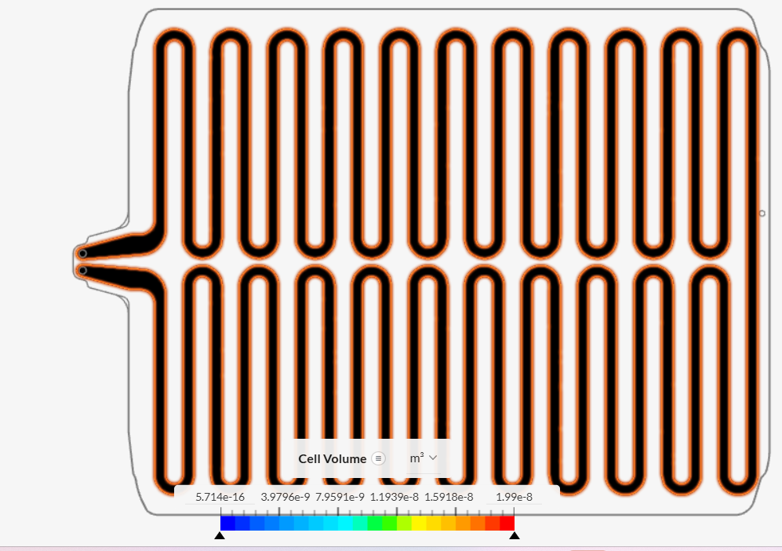
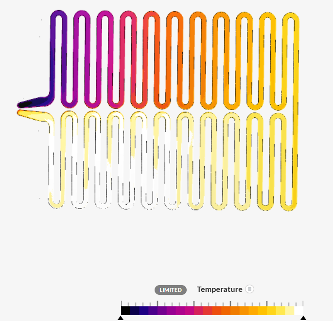
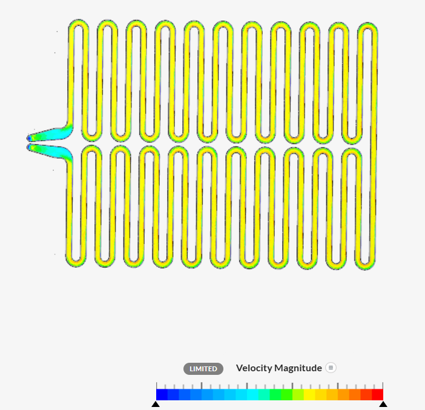
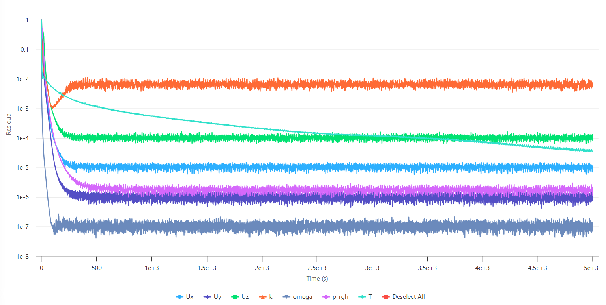
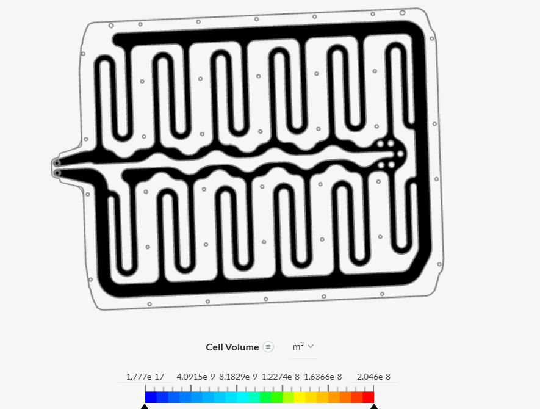
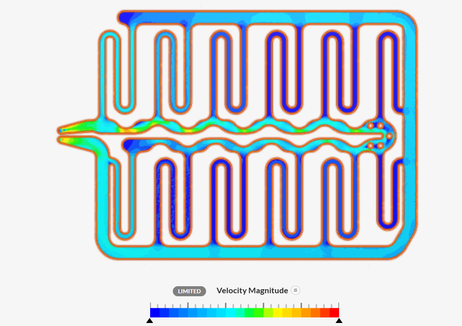
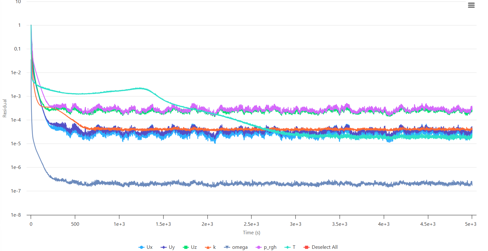

# Comparative CFD and Conjugate Heat Transfer Analysis of Cold-Plate Channel Designs

## 1. Project Overview

This project presents a comparative Computational Fluid Dynamics (CFD) and Conjugate Heat Transfer (CHT) analysis of two cooling-channel configurations for an aluminium cold plate using SimScale.

Both designs were simulated over a duration of **5000 seconds** to investigate coolant velocity distribution, temperature patterns, and numerical convergence under the same operating conditions.

The study examines how changes in cooling-channel geometry influence flow distribution and thermal behavior, with the objective of identifying a more effective configuration for cold-plate thermal management.

## 2. Project Objectives

- Compare coolant flow through two cold-plate channel configurations.
- Analyze velocity distribution within the cooling passages.
- Compare temperature patterns across the aluminium plate.
- Examine numerical convergence over a simulation interval of 5000 seconds.
- Investigate the influence of channel geometry on cooling performance.
- Identify the design with more favorable flow and thermal characteristics.

## 3. Software and Simulation Methodology

| Parameter | Value |
|---|---|
| Simulation Platform | SimScale |
| Analysis Type | Conjugate Heat Transfer (CHT) |
| Flow Regime | Incompressible |
| Turbulence Model | k-ω SST |
| Coolant | 50% ethylene glycol + 50% water |
| Solid Material | Aluminium |
| Applied Surface Heat Flux | 400 W/m² |
| Inlet Pressure | 2000 Pa |
| Outlet Pressure | 20 Pa |
| Ambient Temperature at Outlet Pressure Boundary | 20°C |
| Mesh Fineness | 5 |
| Simulation Duration | 5000 s |

The conjugate heat transfer approach models fluid flow through the cooling channels, heat conduction through the aluminium plate, and heat transfer between the coolant and the solid plate.

The same operating conditions and mesh fineness level were used for both designs to facilitate a direct comparison.

## 4. Coolant Properties

The coolant was modeled as a 50% ethylene glycol–water mixture using constant thermophysical properties.

| Property | Value |
|---|---:|
| Density | 1079 kg/m³ |
| Dynamic Viscosity | 0.003912 kg/(m·s) |
| Kinematic Viscosity | 3.63 × 10⁻⁶ m²/s |
| Specific Heat Capacity | 3473 J/(kg·K) |
| Thermal Conductivity | 0.4257 W/(m·K) |
| Prandtl Number | 31.9 |
| Turbulent Prandtl Number | 0.85 |
| Reference Temperature | 293.15 K |

## 5. Design 1: Closely Spaced Serpentine Channels

### 5.1 Geometry and Mesh

Design 1 consists of numerous closely spaced serpentine cooling passages distributed across the cold plate. The coolant travels through successive channel sections, creating an extended flow path.

This configuration provides multiple cooling passages across the plate.

### 5.2 Temperature Distribution

The temperature contour shows a progressive change in thermal conditions along the serpentine flow path. Darker colours appear near the inlet and initial channel sections, while warmer colours extend across much of the remaining channel network.

The contour indicates that the plate develops warmer regions along substantial portions of the cooling-channel arrangement.

### 5.3 Velocity Distribution

The velocity contour shows coolant flow through the closely spaced serpentine passages. Local velocity variations are visible near the inlet, channel turns, and connecting regions.

Lower-velocity regions appear across portions of the channel network, alongside areas of higher local velocity.

### 5.4 Residual Convergence

The residual history extends to 5000 seconds. The monitored residuals decrease substantially during the initial stages and subsequently fluctuate around relatively stable levels.

Some residuals retain noticeable fluctuations during the later stages of the simulation.

## 6. Design 2: Modified Channels with a Central Manifold

### 6.1 Geometry and Mesh

Design 2 uses a modified cooling-channel arrangement with fewer serpentine passages and a more prominent central distribution manifold.

The modified geometry changes the coolant flow path and the way fluid is distributed through the cooling-channel network.

### 6.2 Temperature Distribution

The temperature contour displays a different thermal pattern compared with Design 1. Cooler colours appear across portions of the upper channel sections, while warmer colours are visible along parts of the lower channels and outer perimeter.

Because both designs use the same numerical temperature range and colour scale, the contours allow direct qualitative comparison. Design 2 shows cooler regions across portions of the plate, indicating a more favorable temperature distribution than Design 1.

### 6.3 Velocity Distribution

The velocity contour shows local velocity variations around the central manifold, channel junctions, and connecting passages.

The modified geometry produces a different coolant distribution compared with Design 1. The velocity field shows areas of higher and lower local velocities throughout the channel network.

### 6.4 Residual Convergence

The residual history extends to 5000 seconds. The residuals decrease substantially during the initial stages and subsequently fluctuate around relatively stable levels.

Some monitored variables exhibit noticeable oscillations during the later stages of the simulation.

## 7. Comparative Analysis

| Parameter | Design 1 | Design 2 |
|---|---|---|
| Channel Configuration | Numerous closely spaced serpentine passages | Modified arrangement with a central manifold |
| Flow Path | Extended serpentine path through multiple sections | Modified path influenced by the central distribution region |
| Velocity Distribution | Lower-velocity regions across portions of the channel network, with local variations | Different flow distribution around the manifold and connecting passages |
| Temperature Distribution | Warmer regions across substantial portions of the plate | Cooler regions across portions of the plate, with localized warmer areas |
| Temperature Colour Scale | Same numerical range | Same numerical range |
| Residual Behavior | Initial reduction followed by fluctuations | Initial reduction followed by fluctuations |
| Simulation Duration | 5000 s | 5000 s |
| Mesh Fineness | 5 | 5 |

## 8. Velocity and Flow Distribution: Discussion

The velocity contours demonstrate that cooling-channel geometry influences coolant distribution throughout the cold plate.

Design 1 uses numerous closely spaced serpentine passages. Its velocity field shows variations along the extended flow path, with lower-velocity regions visible in portions of the channel network.

Design 2 introduces a central distribution manifold that changes the flow path and local velocity distribution around the connecting channels.

The comparison highlights the importance of channel geometry in determining how coolant moves through the plate. The modified arrangement in Design 2 exhibits a different flow pattern that corresponds to the cooler regions observed in its temperature contour.

## 9. Comparative Thermal Performance

Both designs were subjected to the same applied surface heat flux of 400 W/m² and use the same numerical temperature colour scale.

Design 1 exhibits warmer regions across substantial portions of the plate, alongside lower-velocity regions within parts of the cooling-channel network.

Design 2 shows cooler regions across portions of the plate and a different velocity distribution around its central manifold and connecting passages.

The temperature contours indicate that Design 2 provides a more favorable thermal distribution than Design 1. The differences demonstrate how modifying channel geometry can influence the thermal behavior of a cold plate.

## 10. Residual Convergence Assessment

Both simulations show substantial initial reductions in residuals, followed by fluctuations during the later stages.

The residual histories provide information about the numerical behavior of each simulation. The observed fluctuations indicate that the solution behavior should be considered when interpreting the resulting flow and temperature fields.

Further assessment of mass-flow balance, pressure difference, and temperature monitoring quantities would provide additional information about solution convergence.

## 11. Limitations

- Exact maximum and average plate temperatures were not extracted because of limitations in the available SimScale package.
- Pressure-drop values were not extracted for quantitative comparison.
- Heat-transfer rates and thermal resistance were not calculated.
- Individual channel mass-flow rates were not extracted.
- Coolant properties were treated as constant.
- A mesh-independence study was not performed.
- Residual histories show fluctuations during the later stages of both simulations.

## 12. Future Work

- Extract maximum and average plate temperatures for both designs.
- Monitor coolant inlet and outlet temperatures.
- Calculate pressure drop and total mass flow rate.
- Determine heat-transfer rate and thermal resistance.
- Investigate flow distribution among individual cooling passages.
- Perform mesh-independence and convergence studies.
- Investigate the effects of channel width, spacing, and manifold geometry.
- Explore cold-plate applications in hydrogen fuel-cell thermal management.

## 13. Key Findings

- Both channel configurations produce distinct velocity and temperature distributions.
- Design 1 uses closely spaced serpentine passages and exhibits warmer regions across substantial portions of the plate.
- Design 2 uses a central distribution manifold and shows cooler regions across portions of the plate.
- The velocity contours show different coolant distribution patterns between the two designs.
- Both simulations were run for 5000 seconds under the same general operating conditions.
- The temperature contours suggest that Design 2 provides a more favorable thermal distribution than Design 1.
- Channel geometry is an important consideration in cold-plate thermal management.

## 14. Skills Demonstrated

- Computational Fluid Dynamics (CFD)
- Conjugate Heat Transfer (CHT)
- SimScale
- Internal Flow Simulation
- Thermal Management
- Cooling-Channel Design
- Mesh Generation
- k-ω SST Turbulence Modelling
- Pressure-Driven Flow
- Temperature-Field Analysis
- Velocity-Field Analysis
- Residual Convergence Assessment
- Comparative Engineering Analysis
- CFD Post-Processing

## 16. Simulation Platform

The simulations were performed using **SimScale**.

[SimScale](https://www.simscale.com/projects/mehwish_akhtar/cfd_and_thermal_analysis_of_a_cold_plate_for_hydrogen_fuel_cell_cooling_1654571654/)

## 17. Acknowledgment

The cold-plate concept and tutorial workflow were based on the SimScale cold-plate simulation tutorial. The present work was independently configured and analyzed to study the behavior of two channel configurations.

The project is intended as a CFD learning and portfolio study and does not represent a validated experimental design.
